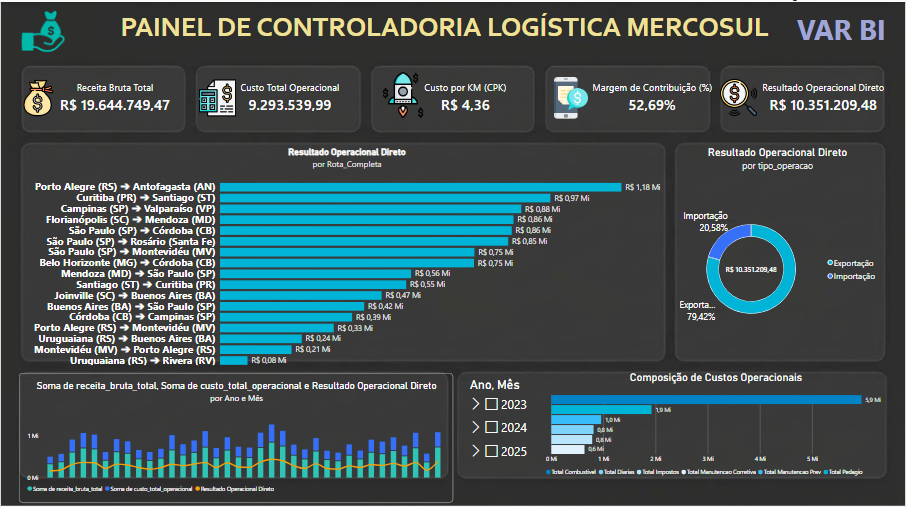
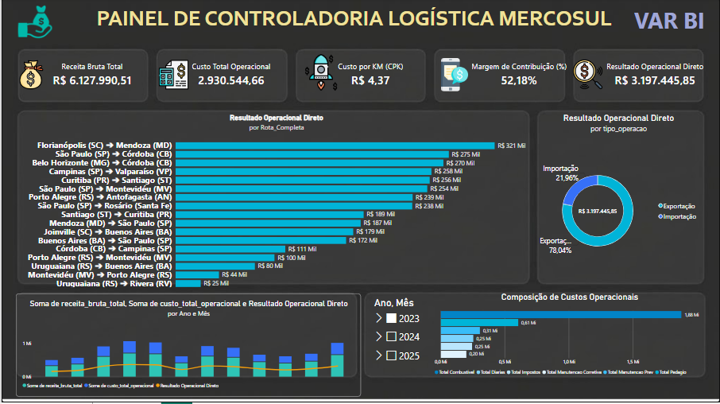

# 📊 Torre de Controle Logística & Rentabilidade de Frotas (Mercosul)

> Projeto de engenharia de dados, controladoria e Business Intelligence focado na otimização de custos e análise de margem de lucro por rota no transporte rodoviário internacional (Brasil – Argentina/Chile).

---

## 🎯 Sobre o Projeto
No transporte internacional de cargas, as empresas frequentemente conhecem o faturamento bruto, mas enfrentam grandes dificuldades para apurar o **lucro real por viagem**. Custos ocultos — como variação de preço do diesel fora do país, pedágios internacionais, manutenções corretivas em rota e o impacto financeiro do tempo de espera nas fronteiras — corroem as margens operacionais silenciosamente.

Este projeto simula um ambiente corporativo real de uma transportadora, estruturando um pipeline completo de dados: desde a extração e tratamento em banco relacional até a entrega de um **Dashboard Executivo de Controladoria** no Power BI.

---

## 🛠️ Arquitetura e Tecnologias
O projeto foi construído utilizando as melhores práticas de mercado:
* **Linguagem:** Python (automação e script ETL).
* **Banco de Dados & Modelagem:** PostgreSQL (Esquema Estrela / Star Schema).
* **Visualização de Dados:** Power BI (Dark Mode corporativo, foco em DRE e KPIs gerenciais).
* **Controle de Versão:** Git e GitHub.

---

## 📐 Modelagem de Dados (Esquema Estrela)
O banco de dados foi estruturado de forma relacional para garantir integridade e performance analítica:
1. **`dim_rota`**: Informações de origem, destino, distâncias em km e tempo médio de fronteira.
2. **`dim_veiculo`**: Frota ativa, placas, modelos e capacidade de carga.
3. **`dim_posto`**: Postos de abastecimento nas rotas internacionais, com controle de moedas e preços do diesel.
4. **`fato_viagens`**: O núcleo operacional que registra cada viagem, unindo custos diretos, receitas líquidas e impostos retidos.

---

## 📈 Principais Indicadores (KPIs) Analisados
O dashboard de controladoria foi desenhado para responder às principais dúvidas da diretoria financeira em segundos:
* **Receita Bruta vs. Líquida:** Faturamento total já deduzido de impostos e encargos aduaneiros.
* **Custo por Quilômetro Rodado (CPK):** O indicador vital de eficiência da frota.
* **Margem de Contribuição por Rota:** Ranqueamento cirúrgico das rotas mais lucrativas e identificação de trechos com margem negativa.
* **Composição de Custos Operacionais:** Detalhamento do peso de cada insumo (Combustível, Pedágio, Diárias, Manutenção Preventiva/Corretiva e Impostos).
* **Mix de Operação:** Proporção de Exportação vs. Importação para otimização de *backhaul* (viagens de retorno).

---

## 📊 Pré-visualização do Dashboard (Dark Mode)

---

## 👨‍💻 Autor
Verlã Acosta Ramos
* *Especialista em Logística Internacional & Análise de Dados*
* www.linkedin.com/in/verla-acosta-ramos | https://github.com/VerlaAcosta1973